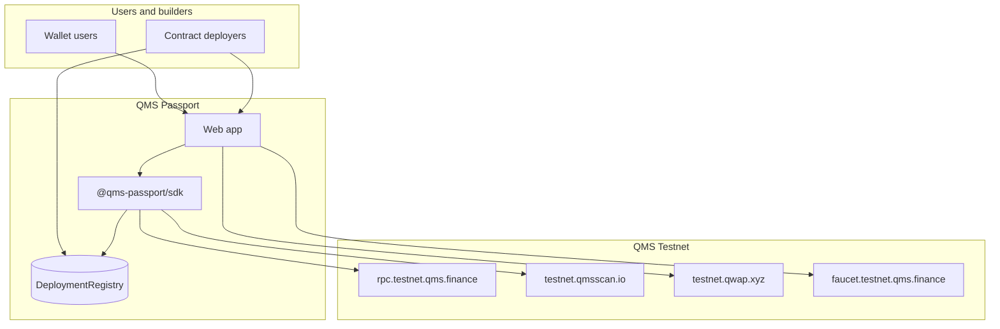

# QMS Passport

**The front door to the useful-work chain** — onboarding, PoUW-aware activity, builder-grade migration tooling, and an open SDK for every team on [QMS Testnet](https://docs.qms.finance/for-developers/network-and-rpc).

> Built for [QMS Builder Program — Cohort I](https://qms.finance/builders-program) (applications open Oct 28 – Nov 18, 2026).

[](https://chainlist.org/chain/19480)
[](https://docs.qms.finance/for-developers/evm-compatibility)
[](LICENSE)

**Repository:** https://github.com/Isaaco3349/QMS-Passport

---

## Why this exists (and why it is not “another dashboard”)

QMS Testnet is already active at scale ([~24M+ indexed transactions](https://testnet.qmsscan.io/api/v2/stats) on QMSScan as of Oct 2026), with **QWAP** as the native AMM and a **December 2026 testnet reset** that will wipe deployments and balances. Most users still bounce between Chainlist, the faucet, QWAP, and QMSScan without ever seeing what makes QMS different: **every block is won by proof-of-useful-work (PoUW) over a QUBO instance**.

**QMS Passport** is a public-good product + SDK that:

1. **Onboards** wallets onto chain `19480` with one guided flow (network → faucet → first action on QWAP).
2. **Explains** each user transaction in terms of the **PoUW block** that included it (with deep links to QMSScan’s QUBO trace and `.mtx.gz` downloads).
3. **Protects builders** across the **testnet reset** with signed deployment manifests, Foundry/Hardhat redeploy templates, and an optional on-chain **Deployment Registry**.
4. **Ships `@qms-passport/sdk`** so other Cohort I teams import QMS-safe patterns (confirmations instead of `finalized`, fee hints, Blockscout helpers) instead of re-learning chain quirks.

We are optimizing for **ecosystem lift** and **core-team partnership**, not a closed demo app.

---

## What you get in this repository

| Area | Path | Status |
|------|------|--------|
| Chain constants & viem/wagmi config | [`packages/chain-config`](packages/chain-config) | Ready |
| Blockscout + RPC helpers (confirmations, exports) | [`packages/sdk`](packages/sdk) | Ready (PoUW enrichment: see [docs/POUW_DATA.md](docs/POUW_DATA.md)) |
| On-chain deployment registry (optional anchor) | [`packages/contracts`](packages/contracts) | Scaffold + tests |
| Product architecture & integration map | [`docs/`](docs/) | Complete |
| Cohort I application narrative | [`builders/APPLICATION_DRAFT.md`](builders/APPLICATION_DRAFT.md) | Complete |
| Web app (Next.js) | [`apps/web`](apps/web) | Alpha (onboarding, activity, migration, badges) |

---

## Quick start (SDK)

```bash
pnpm install
pnpm build
```

```typescript
import { qmsTestnet, QMS_CONFIRMATIONS, ecosystemLinks } from "@qms-passport/chain-config";
import { createQmsscanClient, waitForQmsConfirmations } from "@qms-passport/sdk";
import { createPublicClient, http } from "viem";

const client = createPublicClient({ chain: qmsTestnet, transport: http() });
const scan = createQmsscanClient();

// Never use "finalized" on QMS v0.1 — wait for N block confirmations instead.
await waitForQmsConfirmations(client, txHash, QMS_CONFIRMATIONS.DEFAULT);

const txs = await scan.getAddressTransactions("0xYourAddress");
console.log(ecosystemLinks.qwap); // https://testnet.qwap.xyz
```

---

## Architecture (high level)



Deep dive: [docs/ARCHITECTURE.md](docs/ARCHITECTURE.md).

---

## Official QMS resources (no private SDK required)

Everything in Passport integrates **public** endpoints documented by QMS:

| Resource | URL |
|----------|-----|
| RPC (HTTPS / WSS) | `https://rpc.testnet.qms.finance` / `wss://rpc.testnet.qms.finance` |
| Chain ID | `19480` (`0x4c18`) |
| Explorer (Blockscout) | https://testnet.qmsscan.io — API base `https://testnet.qmsscan.io/api` |
| Faucet | https://faucet.testnet.qms.finance |
| QWAP (DEX) | https://testnet.qwap.xyz |
| Status | https://status.testnet.qms.finance |
| Developer docs | https://docs.qms.finance (see [llms.txt](https://docs.qms.finance/llms.txt)) |
| Builder Program | https://qms.finance/builders-program |

**Rate limits:** public RPC is ~50 req/s per client IP ([Network and RPC](https://docs.qms.finance/for-developers/network-and-rpc)). Passport caches Blockscout reads and batches RPC via Multicall3 (`0xcA11…CA11` on QMS).

**Chain quirks we encode in the SDK:** no blob txs; `safe` / `finalized` tags return genesis; `PREVRANDAO` is zero; probabilistic ~10s blocks. See [docs/INTEGRATIONS.md](docs/INTEGRATIONS.md).

---

## Product pillars (Tier A — expanded)

### 1. Guided onboarding (“Zero → first useful tx”)

- One-click **Chainlist** deep link: https://chainlist.org/chain/19480  
- Faucet walkthrough with **separate test wallet** guidance (matches QMS docs).  
- **Deep links into QWAP** Swap / Explore / Portfolio after balance check.  
- Optional: detect first `QwapRouter` interaction and unlock **“First swap on useful-work chain”** badge.

### 2. PoUW activity narrative (“Your tx, that block’s work”)

For each transaction we show:

- Inclusion block height, timestamp, confirmation depth (not finality).  
- Link to QMSScan block page (QUBO instance hash, objective value, solution, `.mtx.gz`).  
- Plain-language copy: *mining lottery over valid QUBO solutions*, aligned with [How QMS Works](https://docs.qms.finance/overview/how-qms-works-at-a-glance).

**Implementation note:** standard Blockscout `api/v2/blocks/{n}` JSON today does **not** expose PoUW fields; enrichment strategy is documented in [docs/POUW_DATA.md](docs/POUW_DATA.md), including a **collaboration ask** for a stable PoUW JSON field from the QMS team (high-leverage for cohort spotlight).

### 3. Testnet Migration Kit (“December reset insurance”)

Public-good tooling for **all** builders:

- **Local manifest** (JSON): contracts, ABIs, constructor args, commit SHA, deployer, block number.  
- **Export / import** CLI in `@qms-passport/sdk`.  
- **Foundry** template: `packages/contracts/script/RedeployFromManifest.s.sol` (manifest-driven).  
- Optional **DeploymentRegistry** on-chain attestation for cohort showcase verifiability.

Aligned with QMS announcement: *next testnet ~early December 2026, full reset*.

### 4. Achievements & share cards (distribution for QMS)

Verifiable milestones (local + optional on-chain):

| Badge | Trigger (v1) |
|-------|----------------|
| Network citizen | Wallet on `19480` with QMS balance |
| Fueled | Faucet receipt detected |
| QWAP explorer | Router interaction (`QwapRouter`) |
| Builder | Contract creation tx |
| Migration-ready | Exported deployment manifest |

Share images → X / Discord for **cohort marketing** and QMS Builder showcase.

---

## Roadmap (Cohort I)

| Phase | Window | Deliverable |
|-------|--------|-------------|
| **0 — Spec & SDK** | Now | This repo, `@qms-passport/sdk`, docs, contract scaffold |
| **1 — Public alpha** | Nov 2026 | `apps/web` live: onboarding + tx feed + PoUW links |
| **2 — Migration Kit** | Before Dec reset | Export CLI, redeploy scripts, registry deploy on new testnet |
| **3 — Ecosystem** | Post-reset | Embeddable widgets; partner with QWAP + cohort apps |

Details: [docs/ROADMAP.md](docs/ROADMAP.md).

---

## Why QMS core team should care

| Ecosystem pain | Passport response |
|----------------|-------------------|
| High drop-off between faucet and first swap | Single guided funnel into QWAP |
| PoUW is invisible to non-researchers | Default UX surfaces QUBO per block |
| Imminent testnet reset | Migration Kit as **official-friendly** public infra |
| RPC/explorer quirks break generic tooling | SDK documents and enforces safe patterns |
| Builder Program needs showcase projects | Shareable badges + open SDK used by other teams |

**Ask from us to QMS:** dedicated builder channel feedback on PoUW API shape + featured placement as recommended onboarding path (we carry maintenance burden as open source).

---

## Development

```powershell
# Install (Node 20+, pnpm 9+)
pnpm install

# Build all packages + web
pnpm build

# Contracts (Foundry) — PowerShell 5.x: use ; not &&
cd packages\contracts; forge test

# Web alpha
pnpm dev
# → http://localhost:3000
```

**When to push to GitHub:** [docs/PUSH_CHECKLIST.md](docs/PUSH_CHECKLIST.md)

Environment variables for app phase (see `apps/web/.env.example` when added):

- `NEXT_PUBLIC_QMS_RPC_URL` — defaults to public RPC  
- `NEXT_PUBLIC_QMSSCAN_API` — defaults to Blockscout v2  

---

## Security & scope

- **Testnet only.** No mainnet funds, no custody.  
- Manifests may contain ABIs — users sign exports locally; no private keys in repo.  
- We do not impersonate QMS; branding clearly **community / partner** unless core team adopts officially.

Report issues via GitHub Issues. For QMS protocol bugs, use [QMS Discord](https://discord.gg/qms) (verify official links).

---

## License

MIT — see [LICENSE](LICENSE). Contract sources under `packages/contracts` same license unless noted.

---

## Links

- **Apply to Cohort I:** https://qms.finance/builders-program  
- **Application draft in repo:** [builders/APPLICATION_DRAFT.md](builders/APPLICATION_DRAFT.md)  
- **Architecture:** [docs/ARCHITECTURE.md](docs/ARCHITECTURE.md)  
- **Integrations:** [docs/INTEGRATIONS.md](docs/INTEGRATIONS.md)
