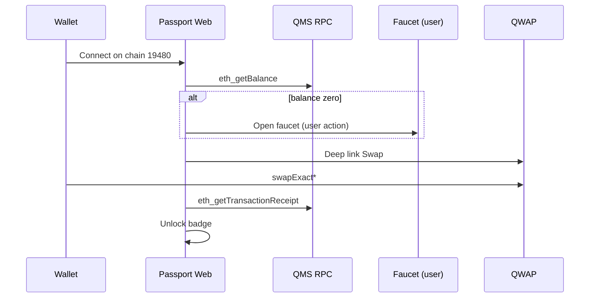
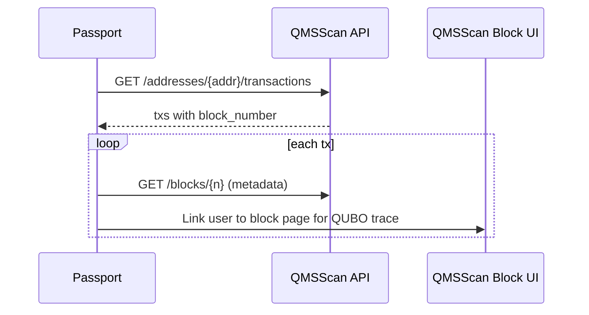

# Architecture

QMS Passport is a **monorepo** split into user-facing app, reusable SDK, chain configuration, and optional on-chain registry. The design prioritizes **correctness on QMS v0.1**, **reset survivability**, and **reuse by other Builder Program teams**.

## Design principles

1. **QMS-native, not Ethereum-assumed** — confirmation-based finality, fee margin guidance, no blob txs, no `PREVRANDAO` randomness.
2. **Public infrastructure only** — no dependency on undisclosed APIs; optional enhancements when QMS exposes PoUW JSON.
3. **Local-first migration** — deployment manifests are portable JSON; chain state is explicitly ephemeral on testnet.
4. **Embeddable SDK** — business logic lives in `@qms-passport/sdk`; the web app is a reference client.

## Components

### `packages/chain-config`

Single source of truth for:

- `qmsTestnet` viem chain definition (matches [Tools and wallets](https://docs.qms.finance/for-developers/tools-and-wallets))
- Confirmation policy constants
- Known ecosystem contract hints (Multicall3, QWAP router from explorer verification)
- External URLs (faucet, QWAP, Chainlist, status page)

### `packages/sdk`

| Module | Responsibility |
|--------|----------------|
| `qmsscan.ts` | Blockscout REST v2 client (address txs, tx by hash, blocks) |
| `confirmations.ts` | Poll until `N` confirmations; never uses `finalized` tag |
| `manifest.ts` | Deployment manifest schema, validate, export/import |
| `pouw.ts` | PoUW link builder + placeholder for future structured API |
| `achievements.ts` | Pure functions: infer badges from tx list |

### `packages/contracts`

Solidity **DeploymentRegistry**:

- `registerDeployment(bytes32 manifestHash, string metadataURI)` — optional public attestation
- Events for cohort transparency
- No custody, no upgrade complexity in v0.1

Foundry scripts:

- `DeployRegistry.s.sol`
- `RedeployFromManifest.s.sol` (reads JSON manifest from disk)

### `apps/web` (Phase 1)

Recommended stack:

- **Next.js 15** App Router
- **wagmi v2 + viem** with `@qms-passport/chain-config`
- Server routes as **thin BFF** for Blockscout (cache 10–30s, respect rate limits)

Pages:

| Route | Function |
|-------|----------|
| `/` | Connect wallet, onboarding checklist |
| `/activity` | Tx list + PoUW block cards |
| `/build` | Register deployments, export manifest |
| `/badges` | Achievement status + share card generator |

## Data flows

### Onboarding checklist

### Activity + PoUW narrative

See [POUW_DATA.md](./POUW_DATA.md) for structured PoUW enrichment.

### Migration export

1. User adds deployment entries in UI (or CLI).
2. SDK validates manifest schema `passport-manifest/v1`.
3. Export signed JSON (optional EIP-712 in Phase 2).
4. After reset: `forge script RedeployFromManifest` with updated RPC.

## Non-functional requirements

| Concern | Target |
|---------|--------|
| RPC usage | Batch reads; cache block data; default public RPC |
| Accessibility | Onboarding readable without reading whitepaper |
| Privacy | No wallet tracking server-side in v0.1; optional analytics with consent |
| Testnet ethics | Prominent “no real funds” banner per QMS onboarding |

## Collaboration surfaces with QMS core team

High-value, low-controversy asks:

1. **PoUW JSON** on Blockscout API or sibling endpoint (`qubo_instance_hash`, `objective_value`, `solution`, `mtx_url`).
2. **Featured link** from docs/onboarding to Passport (if quality bar met).
3. **Reset timeline** feed for Migration Kit countdown (status page RSS or Discord pin).
4. **QWAP** router/factory address registry file in docs (we currently infer from verified contracts on QMSScan).

## Threat model (testnet scope)

- Fake RPC / phishing: we pin chain ID `19480` and show checksum URLs.
- Manifest tampering: optional on-chain `manifestHash` registration.
- No smart contract custody of user assets in Passport v0.1.
